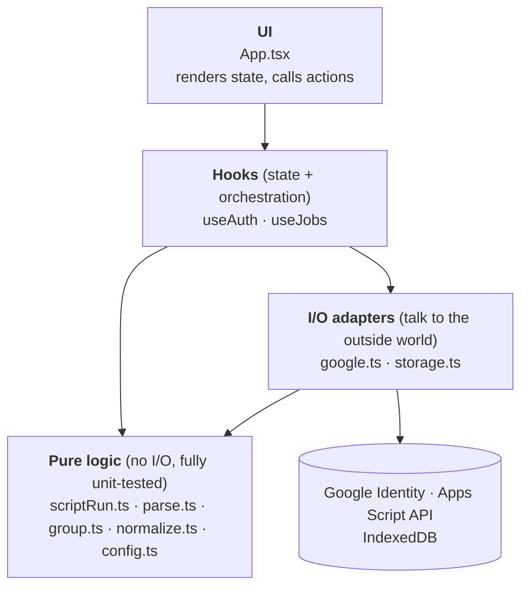
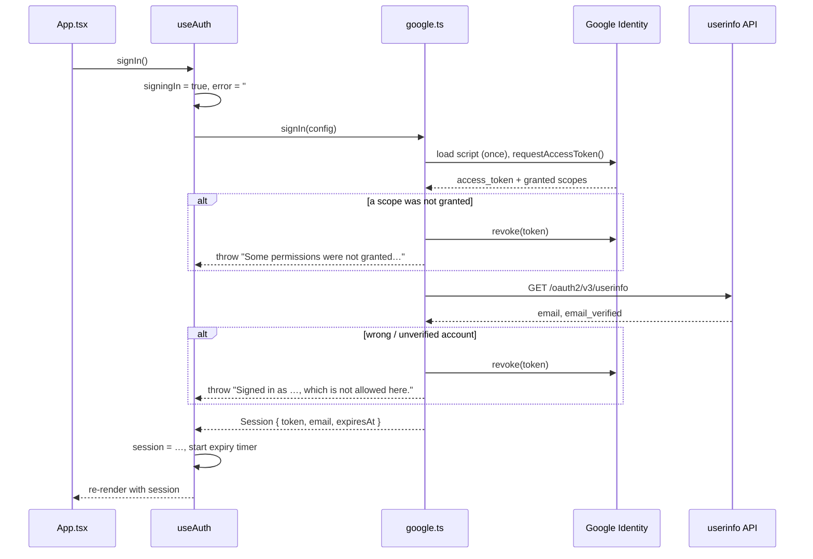
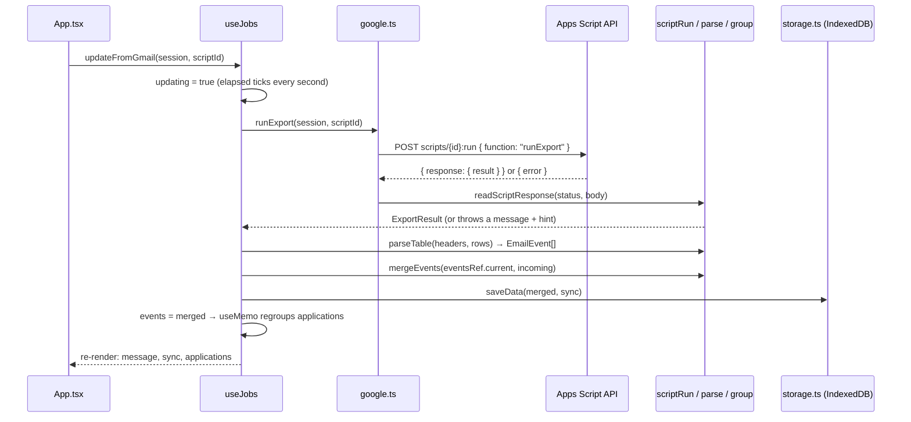

# Architecture

How the web app in `src/` is put together: the layers, the Google API modules, and the two hooks
(`useAuth`, `useJobs`) that hold all the logic. For what the app does, see the [README](../README.md);
for the one-time Google setup, see [SETUP.md](../SETUP.md).

## The pattern in one picture

The app has no backend. It is three layers, and each layer only calls the one below it:



This is two well-known patterns combined:

- **Functional core, imperative shell.** Everything that can be a pure function is one (parsing,
  grouping, classifying, reading an API response). The code that does I/O or holds state is kept
  thin and sits around that core. The pure functions are where the bugs would be, and they are the
  ones with tests (`*.test.ts`).
- **Custom hooks as the controller / view-model.** Each hook owns one area of state, exposes it as
  plain values plus action functions, and hides how the work is done. `App.tsx` only renders: it
  never calls `fetch`, IndexedDB or a parser directly. That is why the current placeholder UI can be
  replaced by the real design without touching any logic.

| Layer | Files | Knows about React? | Does I/O? | Tested? |
|---|---|---|---|---|
| UI | `App.tsx` | yes | no | no (placeholder) |
| Hooks | `hooks/useAuth.ts`, `hooks/useJobs.ts` | yes | through adapters | no |
| I/O adapters | `lib/google.ts`, `lib/storage.ts` | no | yes | partly (`accountProblem`) |
| Pure logic | `lib/scriptRun.ts`, `parse.ts`, `group.ts`, `normalize.ts`, `config.ts` | no | no | yes |

## The API layer (`src/lib`)

### `google.ts`: the Google gateway

The only file that talks to Google. It exposes four functions and hides the protocols behind them:

| Function | What it does |
|---|---|
| `signIn(config)` | Loads Google Identity Services, opens the popup, checks that every scope was granted, checks who signed in, returns a `Session`. |
| `signOut(session)` | Revokes the token so it can't be reused. |
| `runExport(session, scriptId)` | Calls the Apps Script API (`scripts.run`) to run `runExport` in `apps-script/exportJobEmails.gs` as the signed-in user. |
| `accountProblem(email, allowed)` | Pure helper: why this account may not use the app, or `''`. |

Things worth knowing:

- **`Session` is a plain value**: `{ token, email, expiresAt }`. No class, no global. Whoever needs
  to call Google receives it as an argument. `expiresAt` is set a minute before Google's real
  expiry so a call never starts with a token that dies mid-request.
- **The GIS script is loaded lazily and once.** `loadGis()` caches the promise in `gisLoading`
  (`??=`); on a network error it clears the cache so the next click retries.
- **Callback APIs are wrapped in Promises.** Google Identity Services uses callbacks
  (`callback`, `error_callback`); `requestToken` turns them into one `Promise<TokenResponse>`,
  so the rest of the code is plain `async`/`await`.
- **Fail closed.** If the user unticks a permission, or the wrong account signs in, the token is
  revoked immediately and an `Error` with a readable message is thrown.
- **Errors are user-facing messages.** Every `throw` here says what went wrong in words the UI can
  show as is. The hooks just copy `error.message` into state.

### `scriptRun.ts`: the response decoder

`runExport` in `google.ts` does the `fetch`, then hands the status and JSON body to
`readScriptResponse(httpStatus, body)`. That function is pure, which is the point: the tricky part
of the API (the Apps Script API returns the *script's own* errors with HTTP 200 and an `error`
field, and setup mistakes come back as cryptic messages) can be tested without a network.

It also holds `HINTS`, a table of `regex → fix`, which turns messages like
`Requested entity was not found` into "check the Script ID… (SETUP.md, step 5)". To support a new
error, add a row there and a test in `scriptRun.test.ts`.

`ExportResult` is the contract with the Apps Script: `headers`, `rows`, `runInfo`,
`spreadsheetUrl`. If `exportJobEmails.gs` changes what it returns, this interface and
`parseTable` change with it.

### `storage.ts`: the repository

Persists `{ events, sync }` under one key (`'current'`) in IndexedDB. Three functions:
`loadData`, `saveData`, `clearData`.

- **Never throws.** Storage can be blocked (private windows, blocked site data), so `loadData`
  returns an empty list, `saveData` returns `false`, and `clearData` swallows the error. The hook
  decides what to tell the user.
- **Dates are serialised** as ISO strings on save and turned back into `Date` on load; the rest of
  the app only ever sees `Date`.
- `withStore` opens the DB, runs one request in a transaction and always closes it.

### `config.ts`: configuration as a value

`readConfig(env)` is pure and returns `{ config, missing }`; the module then calls it once with
`import.meta.env`. `AppConfig` is passed *into* `useAuth` and `runExport` rather than imported
inside them, so they stay easy to test with any config.

## The hooks (`src/hooks`)

Both hooks follow the same shape:

```ts
function useSomething(inputs) {
  // 1. state: useState for each value the UI shows
  // 2. derived state: useMemo, never stored separately
  // 3. effects: load on mount, timers
  // 4. actions: useCallback(async () => { clear error; set busy; try { call lib } catch { set error } finally { clear busy } })
  return { ...values, ...actions };
}
```

The UI reads the values and calls the actions; it never sees promises or exceptions. Every action
reports failure by setting `error` (a string), and progress by a boolean (`signingIn`, `updating`).

### `useAuth(config)`: sign-in

```ts
const { session, signingIn, error, signIn, signOut } = useAuth(config);
```

| Returned | Meaning |
|---|---|
| `session` | `Session \| undefined`. Signed in when defined. |
| `signingIn` | The popup is open / the account is being checked. Disable the button. |
| `error` | Last sign-in problem, or `''`. |
| `signIn()` | Runs `google.signIn(config)`; on success stores the session. |
| `signOut()` | Revokes the token and forgets the session. |

The session lives **only in React state**: no `localStorage`, no cookie. A reload signs you out, and
a stolen copy of the page's storage contains no token.

Session expiry is an effect that sets a timer for `session.expiresAt - Date.now()`. When it fires,
the session is dropped and `error` explains why. The cleanup function cancels the timer whenever the
session changes (sign-out, a new sign-in), so an old timer can never sign out a new session.



### `useJobs()`: emails and applications

```ts
const jobs = useJobs();
jobs.applications                                // Application[], grouped from the emails
jobs.updateFromGmail(session, config.scriptId)   // Gmail → merge → save
jobs.importCsv(files)                            // fallback: CSV downloads of the spreadsheet
jobs.clear()                                     // forget everything stored in this browser
```

| Returned | Meaning |
|---|---|
| `events` | Every stored `EmailEvent`: the single source of truth. |
| `applications`, `unassigned`, `noise` | Derived from `events` by `groupApplications`. |
| `sync` | Info about the last Gmail update (when, how many, spreadsheet link, warnings). |
| `loaded` | IndexedDB has been read. Until then `events` is empty because it hasn't loaded, not because there are none. |
| `updating`, `elapsed` | A Gmail run is in progress, and for how many seconds (a run can take minutes). |
| `message`, `error` | Last success message / last problem. |

Key design decisions:

- **Store the raw data, derive the rest.** Only `events` and `sync` are state and only they are
  saved. `applications` is recomputed with `useMemo(() => groupApplications(events), [events])`.
  Improve the grouping in `group.ts` and old data is regrouped on the next load, with no migration.
- **Merging, not replacing.** New emails go through `mergeEvents(existing, incoming)`, which
  de-duplicates by Gmail message ID. Running Update twice, or importing a CSV over Gmail data,
  is safe.
- **`eventsRef` avoids stale state in async actions.** `updateFromGmail` awaits a call that can take
  minutes. If it merged into the `events` it closed over when it started, anything that changed in
  the meantime (a CSV import) would be lost. It reads `eventsRef.current` instead, which is updated
  on every render.
- **One write path.** `store(next, nextSync, doneMessage)` updates state, saves to IndexedDB, and
  picks the message (adding a warning when the browser blocks storage). Every action goes through it.
- **The `active` flag** in the load effect stops a late `loadData()` from setting state after the
  component has gone (and under React StrictMode, which runs effects twice in development).



## How the two hooks fit together

The hooks don't know about each other. `useJobs` doesn't call `useAuth`; it receives a `Session` as
an argument at the moment it needs one. `App.tsx` is the only place that composes them:

```tsx
const auth = useAuth(config);
const jobs = useJobs();
if (!auth.session) return /* "Continue with Google" button */;
const { session } = auth;
// …
<button onClick={() => jobs.updateFromGmail(session, config.scriptId)}>Update from Gmail</button>
```

This is dependency injection by argument. It keeps each hook small, lets the stored emails load from
IndexedDB without waiting for sign-in (the current UI still shows them only once signed in, but
that's a UI choice), and means `useJobs` would work unchanged with a different sign-in method.

Note that signing out does **not** clear the stored emails: they belong to the browser, not the
session. Removing them is the separate `jobs.clear()` action.

## Where to put new code

| You want to… | Put it in |
|---|---|
| Change how emails are classified or grouped | `lib/group.ts` / `lib/normalize.ts` + a test |
| Read a new column from the export | `lib/parse.ts` (`parseTable`) and `ExportResult` in `lib/scriptRun.ts` |
| Explain a new Apps Script API error | a row in `HINTS` in `lib/scriptRun.ts` + a test |
| Call another Google API | a function in `lib/google.ts` that takes a `Session`; keep response handling pure |
| Add a user action (e.g. manual corrections) | a new `useCallback` in the hook that owns the data, writing through `store` |
| Add a new area of state unrelated to jobs or auth | a new hook in `src/hooks/`, composed in `App.tsx` |
| Change what's on screen | `App.tsx` (or components it renders), reading only hook values |

The rule of thumb: if it can be a pure function, put it in `lib/` and test it; if it needs React state,
put it in a hook; if it renders, it reads from a hook and nothing else.
